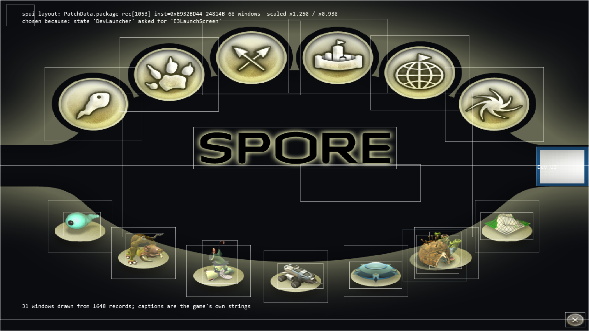
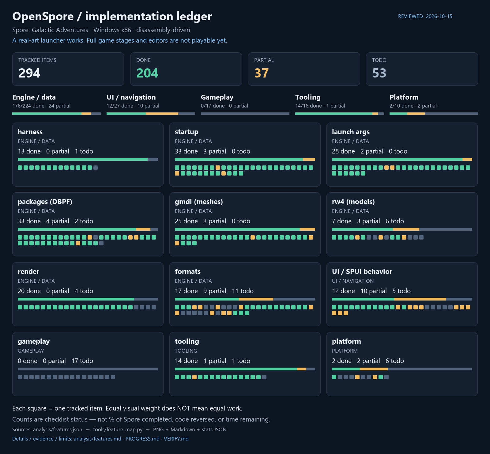

# OpenSpore

### Spore: Galactic Adventures — from a binary to a standalone game

**Windows · x86 · Debug · C++20 · Direct3D 9 · CMake / MSVC · experimental MinGW-w64 cross-build**

OpenSpore is a standalone reimplementation of **Spore: Galactic Adventures**, built from
disassembly of the GA binary and verification against shipped data. The goal is to reconstruct the
path from `Main` to a fully playable game, not merely to open its resources.

> **Right now:** the application boots, reads the game packages, shows the real launcher
> from SPUI and atlases, handles selection of a visible tile and transitions into the right state.
> **But:** the editors and gameplay stages do not work yet. This is a research build, not a Spore replacement.
>
> Last verification: **October 15, 2026**. [Current status](PROGRESS.md) ·
> [Feature checklist](analysis/features.md) · [Evidence](VERIFY.md) · [Continuation plan](RESUME.md)

## No longer just rectangles



This is a **capture of our own `OpenSpore.exe`**, not a mock-up and not a window of the original game.
The screen is selected by the `uilayout -load E3LaunchScreen` command from the `DevLauncher` game
state. The renderer uses the real window hierarchy, atlas UV regions and button state frames.
The light frames and diagnostic labels are still left in intentionally.

**Verified chain:**

```text
boot → DevLauncher → E3LaunchScreen → visible tile → CreatureEditor
                                                       └─ state exists; editor not implemented yet
```

Details and GA addresses: [SPUI binary](analysis/spui-binary.md) · [drawables](analysis/spui-drawables.md).

The next stretch of the Main path is connected too: `Main → GalaxyGameEntry` shows the primary layout
`GlobalUIGGE-9`, confirmed by GA code. This is still an **almost empty diagnostic UI without a
galaxy**, zoom panels and a runtime controller, not a ready game-selection screen.
[Analysis and limitations](analysis/galaxy-entry.md) · [capture](analysis/shots/gge_primary_ui.png).
The [Intro handler](analysis/gge-intro.md) is analysed as well: the C++ model of the post-title gate
checks MoviePlayer/DBCheck conditions. Those services do not exist in the runtime yet, so an explicit
wait is shown, not a fake galaxy-ready state.

## What works — and where the boundary lies

| Area | Implemented and verified | Not ready yet |
|---|---|---|
| Startup | x86 Debug, window, console/log, **10/10** boot markers, capture and fault-tolerance harness | x64 and shipping to regular players |
| Packages | **57/57 DBPF**, **150 945** records; RefPack; CLI unpacking; nested packages | writing/repack, full original resource prioritisation |
| SPUI | **748/748** files to EOF, **93 726** objects, **22 384** windows, **20 659** Children links; shared ancestor Clip for picking/render | WinProcs, dynamic layout/Z-order, shared command dispatcher |
| UI art | UV and logical Image sizes; None-tiling ImageDrawable; non-tiling Standard/Radio; scale/alignment | tiling, outline/shadow, Dialog pieces and the full button event lifecycle |
| Text | locale tables, including nested ones; **1 384 / 1 426** caption refs resolve | the original font renderer, full Unicode/layout |
| Models | supported `gmdl` subset, UV, `raster` DXT1/DXT5/raw; gallery of real models | full RW4, materials, animation and the game world |
| Navigation | visible click `(311,550)` → `CreatureEditor [0x022D9E01]` | the Creature Editor itself and playable stages |

<details>
<summary><strong>Earlier achievement: models and their textures</strong></summary>


This is a separate diagnostic gallery. It confirms reading and rendering of supported assets, **not**
game simulation or completeness of `gmdl`/RenderWare. Details: [formats](analysis/formats.md).

</details>

## Progress without "the game is 80% done"



Each cell is **one item of our checklist**, not a function of the binary and not an equal amount of
work. An open header field, a finished diagnostic tool and a game stage have different complexity.
UI navigation is separated from gameplay: transitioning into an editor does not make the editor ready.

The [full list](analysis/features.md) has statuses, boundaries and evidence links. The weighted index
`(done + 0.5 × partial) / total` is only a supporting checklist metric, **not a percentage of game
completion, code coverage or an estimate of the remaining work**.

```powershell
python tools/feature_map.py          # PNG + Markdown + machine-readable stats
python tools/feature_map.py --check  # check freshness without rewriting
```

Source: [`analysis/features.json`](analysis/features.json). Results:
[`features.md`](analysis/features.md), [`features_stats.json`](analysis/features_stats.json), the PNG
above. The date in the image is the verification date of the source list, not just the date the script
was run.

## Building and running

### Requirements

- Windows and Visual Studio 2022 / Build Tools with **Desktop development with C++** and the Windows SDK.
- CMake 3.25+, the **Win32** generator, the **Debug** configuration.
- Your own legally obtained Spore + Galactic Adventures data. The binaries and `.package` files are not
  included in Git; the original `.exe` is needed for research, not to run our program.
- Python 3.11+ for the research tools; **Pillow** for the progress image.
  The C++ build itself does not require Python.

```powershell
# From the repository root
cmake -S . -B build -G "Visual Studio 17 2022" -A Win32 -DCMAKE_BUILD_TYPE=Debug
cmake --build build --config Debug --target OpenSpore spui_verify pkg_lifetime_verify overlay_clip_verify mode_ui_verify gge_intro_verify gge_dbcheck_verify gge_catalog_verify starsdb_verify starsdb_inspect starsdb_links_verify starsdb_context_verify starsdb_context_inspect starsdb_dbpf_verify starsdb_dbpf_inspect starsdb_postload_verify save_header_verify save_header_inspect planet_record_verify gge_star_present_verify gge_star_instance_verify gge_star_phase1_verify gge_image_verify gge_animated_verify gge_star_lifecycle_verify gge_streaming_image_verify gge_star_scene_verify gge_star_transition_verify gge_star_input_verify gge_catalog_snapshot_inspect
```

Data layout next to the built executable:

```text
build/bin/Debug/
  OpenSpore.exe
  Data/                 # base .package files, Locale/<lang>/, Config/
  DataEP1/              # Galactic Adventures .package files and Config
  UserData/             # created by the application
```

The data must keep its own structure; do **not** rename `.package` to `.package.big`. The numbers in
the tests refer to a specific verified set of 57 packages, not to any installation.

```powershell
cd build/bin/Debug

# The real launcher; close the window manually
.\OpenSpore.exe -w -devDirs -state:DevLauncher

# Short unattended run with a screenshot
.\OpenSpore.exe -w -devDirs -state:DevLauncher -quitAfter 30 -capture launcher.bmp -captureAfter 20

# Regression of the visible transition; the editor does not work after the transition yet
.\OpenSpore.exe -w -devDirs -state:DevLauncher -quitAfter 18 -exec spui:-click,311,550

# Main -> GalaxyGameEntry: only the confirmed primary UI subset, no galaxy simulation
.\OpenSpore.exe -w -devDirs -state:Main -quitAfter 30 -capture gge.bmp -captureAfter 20
```

`-quitAfter` is given **in frames**, not seconds. For automated runs, always pass it explicitly.
The log is `build/bin/Debug/OpenSpore.log`, open for concurrent reading and appended between runs.

### Linux (experimental MinGW-w64 cross-build)

OpenSpore can also be built from Linux as a Windows PE32/i386 executable using the MinGW-w64 x86 cross
toolchain. This is **Linux-hosted cross-compilation of a Windows target, not a native Linux port**: the
output is a Windows `.exe` and the Win32/Direct3D 9 dependency is unchanged. Running it under
Wine/Proton is optional smoke-test evidence only. The MSVC build above remains the officially supported
configuration; every source/CMake delta for the cross-build is inert for MSVC.

Requirements: `i686-w64-mingw32-g++` (GCC) and `i686-w64-mingw32-windres`, CMake 3.25+ and Ninja.

```bash
cmake -S . -B build-mingw32 -G Ninja \
      -DCMAKE_TOOLCHAIN_FILE=build-tools/mingw-w64-i686.cmake \
      -DCMAKE_BUILD_TYPE=Debug
cmake --build build-mingw32 --target OpenSpore
# output: build-mingw32/bin/Debug/OpenSpore.exe
```

The verification targets cross-compile too, for example:

```bash
cmake --build build-mingw32 --target \
  spui_verify mode_ui_verify starsdb_verify starsdb_links_verify starsdb_context_verify \
  starsdb_dbpf_verify starsdb_postload_verify save_header_verify planet_record_verify \
  pkg_lifetime_verify overlay_clip_verify
```

The `.exe` is dynamically linked: copy `libgcc_s_dw2-1.dll`, `libstdc++-6.dll` and
`libwinpthread-1.dll` (from `/usr/i686-w64-mingw32/bin/`) next to it, alongside the UCRT. Measured
toolchain versions, evidence and limits: [analysis/mingw-cross-build.md](analysis/mingw-cross-build.md).

### Checks

From the repository root:

```powershell
$fixtures = Join-Path $env:TEMP 'OpenSpore-spui-fixtures'
python tools/spui_objects.py --parse --all --output analysis/audit/spui_objects.json --extract $fixtures
.\build\Debug\spui_verify.exe $fixtures
.\build\Debug\mode_ui_verify.exe
.\build\Debug\gge_intro_verify.exe
.\build\Debug\gge_dbcheck_verify.exe $fixtures
.\build\Debug\gge_catalog_verify.exe
.\build\Debug\starsdb_verify.exe
.\build\Debug\starsdb_links_verify.exe
.\build\Debug\starsdb_context_verify.exe
.\build\Debug\starsdb_dbpf_verify.exe
.\build\Debug\starsdb_postload_verify.exe
.\build\Debug\save_header_verify.exe
.\build\Debug\planet_record_verify.exe
.\build\Debug\gge_star_present_verify.exe $fixtures
.\build\Debug\gge_star_instance_verify.exe $fixtures
.\build\Debug\gge_star_phase1_verify.exe $fixtures
$imageCapture = Join-Path $env:TEMP ('OpenSpore-image-' + [guid]::NewGuid() + '.bmp')
.\build\Debug\gge_image_verify.exe $fixtures .\build\bin\Debug\Data\PatchData.package $imageCapture
$frameCapture = Join-Path $env:TEMP ('OpenSpore-frame-' + [guid]::NewGuid() + '.bmp')
.\build\Debug\gge_animated_verify.exe $fixtures .\build\bin\Debug\Data\Spore_Graphics.package $frameCapture
.\build\Debug\gge_star_lifecycle_verify.exe $fixtures .\build\bin\Debug\Data\PatchData.package .\build\bin\Debug\Data\Spore_Graphics.package
$streamDir = Join-Path $env:TEMP ('OpenSpore-stream-' + [guid]::NewGuid())
.\build\Debug\gge_streaming_image_verify.exe .\build\bin\Debug\Data\Spore_Graphics.package $streamDir
.\build\Debug\gge_star_scene_verify.exe $fixtures .\build\bin\Debug\Data\Spore_Graphics.package
.\build\Debug\gge_star_transition_verify.exe $fixtures
.\build\Debug\gge_star_input_verify.exe $fixtures

# controlled clickable host-card preview (Debug/dev only; not native GGE)
.\build\bin\Debug\OpenSpore.exe -w -devDirs -state:GGEHostPreview
.\build\Debug\pkg_lifetime_verify.exe .\build\bin\Debug\Data\Locale\en-us\UI.package
$clipCapture = Join-Path $env:TEMP ('OpenSpore-scissor-' + [guid]::NewGuid() + '.bmp')
.\build\Debug\overlay_clip_verify.exe $clipCapture
python tools/pkg_kinds.py
python -m unittest discover -s tools/tests -p 'test_*.py'
python tools/feature_map.py --check
python tools/docs_check.py
```

Last verification: **748** corpus matches, **486** malformed inputs rejected atomically, drawable
UV/state/scale/alignment and ancestor Clip checks PASS; **544** scoped package cycles under a CRT limit
of **512**. A separate D3D9 readback checks the real pixels of the flat/image quad, text flush and
scissor reset. The GGE post-title gate passes **2040** checks on controlled signals; this is not an
observation of the original game and not an implementation of MoviePlayer/DBCheck. `gge_dbcheck_verify`
separately checks the DBCheck subset through an explicit backend and a real dialogue fixture: branches
for a missing/unknown manager, callback order, cleanup and the link to Intro. The live backend is not
connected yet; [state 2 Play Spore](analysis/gge-dbcheck-play.md) needs a real game catalogue, per-star
UI and scenes, not a forced reveal of hidden panels. A [catalogue record build](analysis/gge-catalog.md)
from typed metadata has been added: order, indices, positions, stages, image fallback and a comparison
of two save-header fields. It is verified on controlled inputs; the catalogue producer and the live
galaxy are not implemented yet. For the [`stars.db` serialiser](analysis/starsdb.md) a read-only prefix
inspector and a caller-selected wire subset were added: framing, six metadata fields, references/cells
and 14 StarRecord fields. [Object context](analysis/starsdb-context.md) now reads the index and class
stream, checks the envelope CRC and links `(class_id, token)` to a record. A read-only
[DBPF adapter](analysis/starsdb-dbpf.md) connects these readers to the exact root/index/class keys.
**240 + 362 + 126 + 266** synthetic checks pass; post-load fixups and the live producer are not
connected, and real saves are not verified by this test. Separately, a [save-header
reader](analysis/save-header.md) reads the GA-schema fields `mFileVersionMajor/Minor` from an explicitly
selected DBPF: **116** controlled checks, with no save discovery. The post-load model was corrected:
**15** checks of the empty-name / `BAD_DATA` marker branch; the earlier description "canonical-name
mismatch cleanup" was wrong. The generator and services do not run yet. A [planet-record reader and
saved adapter](analysis/planet-record.md) link the selected planet name, star fields and
header/terrain observations to a typed GGE record: **291** controlled checks. This is not a galaxy on
screen yet: camera/effects/per-star UI and real sources are not connected. The [visual GGE
section](analysis/gge-star-present.md) now includes projection computation, placement and per-star UI
stage configuration: **50** checks, two real layouts with **152 objects / 58 windows**. Camera creation
and mounting these instances into the runtime are still missing; the visible GGE is unchanged so far. A
[host layer of independent star UI instances](analysis/gge-star-instance.md) was added: **167** checks
of ownership, movement, flags, caption refs and pixel picking. The shared renderer now has a
pixel-layer hook; native plugins/callbacks/scene and automatic connection to GGE are still not
implemented. The [phase-1 binding plan](analysis/gge-star-phase1.md) adds **247** checks of binding
order and branches for images/controls, without executing the services. Finding a unique target or the
presence of a resource key is not counted as a successful load; the visible screen is unchanged so far.
The next [image path](analysis/gge-image-bindings.md) already applies a really decoded PNG to the
ImageDrawable of a host instance: **80** checks, preservation of atlas UV/sizes, instance isolation and
a controlled D3D9 pixel readback. The Animated Icon and the whole GGE scene are not implemented by
this. A separate [static Animated Icon selector](analysis/gge-animated-icon.md) now adds **159**
checks: frame selection in the atlas, per-window state and a controlled multi-row GPU test. Auto
Play/native normalisation/full GGE scene remain outside this step. The new [host
lifecycle](analysis/gge-star-lifecycle.md) combines these operations: **232** checks of ownership,
retries, stale tickets, separate action statuses, UTF names and centring. Its independent host actions
do not mean the native phase-1 is finished; there is no automatic GGE caller yet. Now a [streaming
provider](analysis/gge-streaming-images.md) feeds the atlas directly from the large original
`Spore_Graphics.package`, without a test DBPF carrier: **95** checks, bounded index/resource reads and
64-bit offsets (verified on sparse data/index above 2 GiB). It does not change the old memory-adapter
limits. A [host scene collector](analysis/gge-star-scene.md) was added: **204** checks of an explicit
Available catalogue, active-camera observation, placement/layer views and picking. Loss of the
camera/catalogue disables the old draw/pick frames; native factories/effects/visible galaxy and an
automatic GGE caller are not implemented. An [explicit show/phase
subset](analysis/gge-star-transition.md) was restored: **195** checks of cases2..5 with a separate
current-phase observation. Case2 makes a real panel hittable without removing root IgnoreMouse; case4
does not write the native latch even on return1. Services/input dispatch/latch and the GGE runtime are
not substituted. A separate [input seam](analysis/gge-star-input.md) adds **29** world-ray picker
checks: it is separated from UI-window hit and does not call F8/FC, phase or CommandID. For manual
poking there is an explicitly labelled [GGEHostPreview](analysis/gge-host-preview.md): three cards,
real SPUI/atlas and a real input latch. This is a controlled reconstruction, not a live GGE state. A
verified unattended run prints `picked host card 20481 (host only)` and exits with code 0. The next
blocker is described in the [catalogue producer boundary](analysis/gge-catalog-producer.md): the native
manager vector/order `DF95A0` are restored, but there are no real `stars.db`/save data and synthetic
entries are not connected as a production catalogue. For an explicitly passed capture file,
`ggepreview:load,<path>` appeared; the format and strict checks are described in
[gge-catalog-snapshot.md](analysis/gge-catalog-snapshot.md). Without the command, the preview stays
controlled. The snapshot can be checked separately via `gge_catalog_snapshot_inspect <snapshot>`
without starting the UI. These are different checks: parser correctness does not prove UI/gameplay
completeness.

### Useful CLI

From `build/bin/Debug`:

```powershell
.\OpenSpore.exe -headless -devDirs -quitAfter 8 -exec state:-list
.\OpenSpore.exe -headless -devDirs -quitAfter 8 -exec pkg:-unpack,all,C:\SporeDump,png
.\OpenSpore.exe -headless -devDirs -quitAfter 8 -exec pkg:-unpack,all,C:\SporeDump,raster
.\OpenSpore.exe -headless -devDirs -quitAfter 8 -exec pkg:-unpack,all,C:\SporeDump,gmdl
```

Supported rasters are exported to BMP, `gmdl` to OBJ with a paired texture/MTL; unsupported variants do
not automatically become usable models. `-headless` creates no window and no D3D device. Choose the
output path yourself: unpacking can take a lot of space.

## How the reverse engineering is done

1. **Address oracle — only GA-unpacked:** `refs/bins/ReleaseGA/SporeApp.exe.unpacked.exe`.
2. Instructions/decompilation → verification against shipped data → limited implementation → test/capture.
3. Persistent Ghidra and REA are used for binary evidence; results are saved under `analysis/audit/`.
4. The Beta EXE/PDB is a semantic reference, **not a source of GA addresses**.
5. Observations, hypotheses and our presentation policies are labelled separately.

Required reading: [original brief](PROMPT.md), [field guide](reimplementation-field-guide.md),
[toolchain](analysis/toolchain-rea.md). The boundaries of the function register are explained in
[functions.md](analysis/functions.md): the manual catalogue is **not** a complete estimate of the
binary's coverage.

## Documentation and the next step

| Document | Purpose |
|---|---|
| [PROGRESS.md](PROGRESS.md) | current capabilities, limitations and repeatable checks |
| [RESUME.md](RESUME.md) | a short hand-off and the immediate tasks |
| [VERIFY.md](VERIFY.md) | evidence ledger: addresses, evidence type, refutations |
| [analysis/README.md](analysis/README.md) | navigation of the research, generators and archives |
| [MEMORY.md](MEMORY.md) | durable conclusions and traps; older sections are explicitly historical |
| [IDEAS.md](IDEAS.md) | roadmap, deferred ideas and refuted hypotheses |
| [HISTORY.md](HISTORY.md) | chronology: what was verified at the time, not the current status |

Renderer clipping is already aligned with hit testing in the current presentation policy. The nearest
path: the missing drawable/event branches, then `GalaxyGameEntry` and `AppMode` behaviour. The detailed
plan is in [RESUME.md](RESUME.md).

## Provenance of materials

A research project, not affiliated with or endorsed by EA/Maxis. The original executables, PDBs and
game packages are not included in the repository. The documentation contains captures with game
artwork and static fragments of analysis; this is not a claim of ownership of EA content and not a
licence for it. The `assets/OpenSpore.ico` icon is user-provided work for the project.
